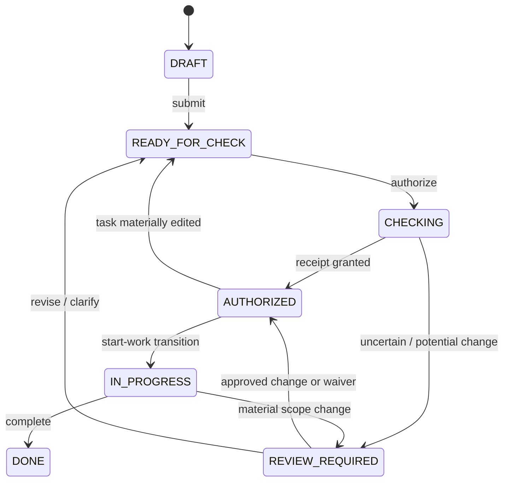
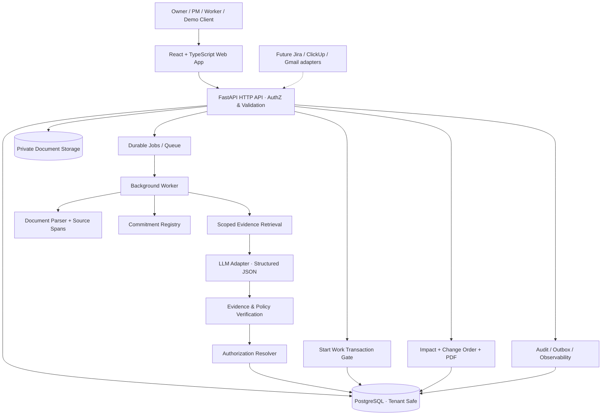
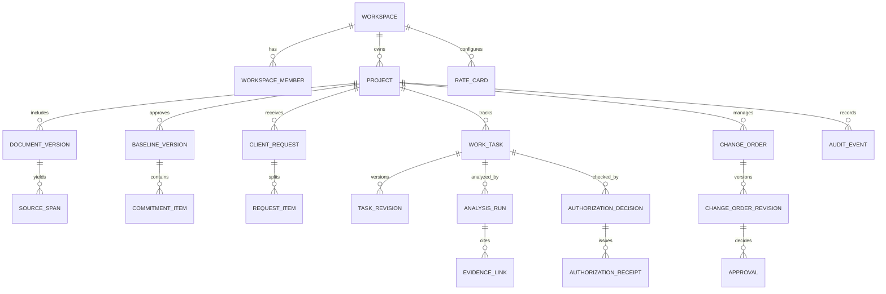
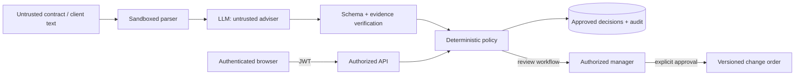

# TERMRAIL — MASTER PRODUCT & ENGINEERING SPECIFICATION

> **TermRail: The Commercial Control Layer for Work**  
> *Every task. Backed by an agreement.*  
> **Версия:** 1.0 · **Дата:** 07.11.2026 · **Статус:** проектная спецификация, НЕ отчёт о реализованном приложении  
> **Тип:** AI-native B2B SaaS · Agreement-to-Execution Infrastructure · Evidence-first Decision System  
> **Назначение:** основателю, product/engineering команде, Claude Code / Codex, дизайнерам, QA, участникам Pitch Battle  
> **Базис:** новое архитектурное позиционирование: не добавить функций в анализатор договоров, а изменить точку контроля — **от обнаружения в переписке к разрешению работы до её начала**.  
> **Конкурс:** Zhambyl Hub Pitch Battle; ориентир: заявка до 08.11.2026 23:59, выступление 10.11.2026 в 14:00 (перепроверить первичный регламент).  
> **Главное правило:** все численные примеры, результаты, цены и показатели ниже — учебные/целевые, пока не измерены. Запрещено показывать вымышленные «реальные» продажи, точность или сэкономленные деньги.

---

## 0. Как пользоваться документом

**Это единый source of truth для реализации**, но не повод игнорировать существующий код. Если репозиторий содержит прошлую версию продукта, coding agent обязан сначала исследовать архитектуру, миграции, тесты и рабочие сценарии, затем провести аккуратную эволюцию и составить список изменений. При конфликте этой спецификации с проверяемыми инвариантами существующей системы — зафиксировать конфликт и предложить безопасный путь миграции, не удалять данные.

**Быстрый маршрут:**

- **Основатель и жюри:** разделы 1–5, 8–9, 18–20.
- **Backend / AI:** разделы 6–7, 10–15.
- **Frontend / UX:** разделы 8–9, 16.
- **Claude Code:** прочитать всё, затем исполнять разделы 17, 21 и финальный master prompt.
- **QA:** разделы 11, 14, 17, 19 и приложения.

### Обозначения

- **P0** — обязательно работает в MVP для питча.
- **P1** — пилот с первыми компаниями.
- **P2** — SaaS после проверки спроса.
- **TARGET** — желаемый уровень, не измеренный результат.
- **DEMO** — заведомо синтетические, честно обозначенные данные.
- **GATE** — переход состояния, который проверяется на сервере.
- **CAP** — *Commercial Authorization Protocol*, внутренняя модель проверки коммерческих оснований работы, **не** отраслевой стандарт и **не** юридический сертификат.

---

# ЧАСТЬ I. ПРОДУКТ, КОТОРЫЙ ЖЮРИ ПОЙМЁТ ЗА 15 СЕКУНД

## 1. Сильная история: что именно мы меняем

### 1.1 Проблема не в договорах, а в разрыве между двумя системами

У небольших агентств и подрядчиков есть два несвязанных мира:

1. **Commercial truth** — подписанный договор, SOW, приложения, бюджет, согласованные изменения, гарантии и ограничения.
2. **Execution truth** — реальные задачи, сроки, исполнители и кнопка «начать работу» в Jira, ClickUp, Linear, Trello или собственной доске.

Клиент просит «ещё одну маленькую функцию». Менеджер создаёт задачу. Разработчик начинает работу. Договор и экономические последствия проверяются поздно — или не проверяются вообще. Получаются неоплаченные часы, споры и непредсказуемая маржа.

**TermRail вставляет проверяемый коммерческий слой между обязательством и выполнением.**

> **Jira знает, ЧТО делает команда. TermRail проверяет, НА КАКИХ СОГЛАСОВАННЫХ УСЛОВИЯХ она это делает.**

Это главный тезис. Не разбавлять его обещаниями универсального AI-агента, «юриста в кармане» или набора бесконечных интеграций.

### 1.2 Основной Job-to-be-Done

> «Прежде чем сотрудник начнёт работу, я хочу знать: входит ли задача в утверждённые обязательства, есть ли основание для выполнения, и если требуется изменение — какое решение и кем принято».

### 1.3 Обещание результата

- **Сотруднику:** не нужно читать 30 страниц договора ради каждой задачи; по понятной задаче появляется короткий статус.
- **Менеджеру:** спорные случаи превращаются в готовое, доказательное коммерческое решение — без ручной охоты за цитатами.
- **Клиенту:** неоправданные счета не выставляются автоматически; основания прозрачны, есть возможность оспорить и уточнить.
- **Основателю агентства:** меньше необсуждённой дополнительной работы; ответственность и история изменений остаются внутри проекта.

**Не обещаем:** юридическую обязательность AI-решений, точность 100%, гарантированный возврат средств, запрет любого незапланированного труда, абсолютную уникальность на рынке, реальную экономию до пилота.

### 1.4 Наша категория

**AI-native Commercial Authorization Layer / Agreement-to-Execution Control**.

Это гипотеза продуктовой категории, которую можно защищать через специфическую архитектуру, UX и пилоты. Рынок scope-management уже занят: ScopeGuard, ScopeGov и другие заявляют анализ SOW, обнаружение допработ, согласования и коммерческие документы. Наша ставка — **момент применения решения к конкретной задаче и контроль изменения состояния между договором и работой**, а не только сумма существующих функций.

### 1.5 Один killer moment

На экране есть обычная задача: **«Добавить онлайн-оплату»**. Пользователь нажимает «Start Work».

- Без доказанного коммерческого основания TermRail не выдаёт разрешение: `REVIEW_REQUIRED`.
- Слева виден **пункт утверждённого SOW**, по которому онлайн-оплата прямо исключена.
- Справа — готовый проект Change Order с рассчитанной ценой из **заданного** rate card.
- Менеджер утверждает предложение; клиентская сторона в демонстрации подтверждает изменение.
- TermRail создаёт новую версию обязательств и выдаёт **Authorization Receipt**.
- **Та же задача** теперь открывается как `AUTHORIZED_BY_CHANGE` и может начаться.

**Не просто анализ. Состояние рабочего процесса действительно изменилось.** Вот момент, который должен запомниться жюри.

---

## 2. Позиционирование, рынок и честное отличие

### 2.1 За какую работу клиент платит

Покупают не модель и не PDF-chat. Покупают снижение затрат менеджера на коммерческую проверку, управляемость ожиданий клиента, защиту маржи и документированную историю решений.

### 2.2 Начальная аудитория (beachhead)

**P0:** веб-/digital-агентства и IT-подрядчики с 2–20 сотрудниками, фиксированными проектными бюджетами, постоянными клиентскими изменениями, хотя бы минимальными SOW/ТЗ и таск-трекером. Их легко понять за три минуты, а ошибки оценивать на примерах.

**Позже:** дизайн, маркетинг, консалтинг, no-code агентства, технические сервисы. Архитектура универсальна, но **маркетинг нельзя начинать с «для всех и всего»**.

### 2.3 Дифференциация: не набор фич, а контрольный контур

| Ось | Типичный AI-анализ scope | TermRail (целевое позиционирование) |
|---|---|---|
| Точка входа | Входящее письмо / договор | Задача **перед началом исполнения** |
| Главный вопрос | «Новая ли это работа?» | «**На каком утверждённом основании** мы её делаем?» |
| Объект контроля | Отдельный запрос | Задача + версия обязательств + решение |
| Выход | AI-флаг и change order | `AuthorizationDecision` и проверяемый статус исполнения |
| История | Обнаружения и документы | Цепочка **agreement → commitment → task → authorization → approval** |
| Ошибки | Риск ложного флага | Консервативный review и override с аудитом |
| Проверка успеха | Сколько флагов нашли | Сколько задач прошли корректную проверку **до старта** |

Это **сравнение нашей стратегии**, а не гарантия, что все конкуренты не имеют этих возможностей. Не использовать фразу «первый в мире».

### 2.4 Что должно стать конкурентным барьером через время

1. Версионная база подтверждённых обязательств — не только исходные PDF.
2. Процесс принятия решений с подтверждениями, отменами и сохранёнными основаниями.
3. Устойчивые интеграции в операционный workflow компаний.
4. Доверие благодаря проверяемым решениям и **консервативным действиям при неопределённости**.
5. Набор качественно размеченных анонимизированных eval-case (только на законных основаниях, без использования чужих конфиденциальных данных для обучения без разрешения).

До первых клиентов это **стратегические гипотезы**, а не готовый moat.

### 2.5 Naming / brand constraints

**TermRail** — рабочее новое имя. Его свободный домен и товарные знаки **не подтверждены**; перед публичным запуском проверить домены и реестры товарных знаков. Не представлять проверку обычного веб-поиска как юридическую clearance.

Бренд: серьёзный B2B инструмент, который работает быстро и незаметно. Не «злой AI, который запрещает работу». Образ: **«rail / control / trusted passage»**, точность, следы, прозрачность.

---

## 3. Основные персоны и двустороннее доверие

| Персона | Боль | Важное действие | Не приемлемо |
|---|---|---|---|
| Owner / Founder | неуправляемые допчасы | увидеть коммерческий риск | ложные суммы «сэкономлено» |
| PM / Account Manager | каждую просьбу приходится выяснять | одобрить/обоснованно отклонить | задержать команду без причины |
| Specialist | неизвестно, надо ли делать | увидеть понятный статус task | неясная блокировка, тупик |
| Client Reviewer | не знает, почему попросили доплату | ознакомиться с аргументами | односторонний «AI решил» |
| Auditor / Finance | нет истории решений | проверить происхождение суммы | неподтверждённая правка задним числом |

**Фундаментальный принцип:** защита **обеих** сторон. Если задача уже включена в договор или является гарантийным bug fix, TermRail помогает это признать, а не монетизировать любой клиентский запрос.

---

## 4. Scope и ограничения на старт

### 4.1 P0 / Pitch MVP — одна железобетонная цепочка

**Обязательно end-to-end на реальных вызовах и сохранённых данных:**

1. Вход пользователя (Supabase Auth или другой безопасный проверенный auth) и минимум один workspace.
2. Создание проекта: клиент, budget, currency, параметры работы.
3. Загрузка **текстового PDF** с сохранением исходника, версий и SHA-256; просмотр документа с выделением фрагментов.
4. Извлечение `scope_items`, `exclusions`, `revision_limits`, `change_policy`, `warranty_terms`; **ручное утверждение baseline v1**.
5. Ввод клиентского запроса + создание связанной рабочей задачи во внутренней доске.
6. AI-разбор запроса на атомарные требования + поиск источников + категоризация + серверная проверка доказательств.
7. **Commercial Authorization Check** непосредственно перед `Start Work`.
8. Для спорного расширения — Draft Change Order; стоимость из заданной ставки и введённых часов (не hallucinated).
9. Approval Manager, DEMO Client Accept/Decline через отдельную роль в **внутреннем** интерфейсе (не фиктивный внешний email).
10. Создание `baseline v2` после подтверждения и изменение статуса той же задачи.
11. Authorization Receipt с provenance/version hashes + audit trail, видимый в UI.
12. Экспорт PDF с явно указанным статусом: `DRAFT`, `APPROVED_INTERNAL`, `ACCEPTED` (без ложной юридической «подписи»).
13. Три реальных тестовых пути: **change**, **bug fix**, **ambiguous**.
14. Доступный без правок кода демо-маршрут с синтетическими данными, плюс доказательства, что пайплайн вызывает настоящую БД/модель.

### 4.2 Не обязательно для Pitch MVP

Gmail OAuth, Slack, Jira workflow validators, ClickUp блокировка, юридическая e-signature, подписочный биллинг, сложный RAG-кластер, multi-provider AI router, графовая СУБД, мобильные приложения, английская и казахская полные локализации, реальные письма клиентам. **Эти функции нельзя рисовать в интерфейсе как действующие.** Можно отдельно показать Roadmap.

### 4.3 P1 / Paid Pilot

- Jira/ClickUp/Linear адаптеры, **per-adapter capability matrix** (read-only, notify, two-way, true gate).
- Изолированный Client Portal с проверенным доступом и юридически корректным workflow согласования.
- Gmail/Slack ingestion с scoped access, revoke и периодической синхронизацией.
- Margins/budget view при наличии достоверного time tracking.
- Role-based approvals, billing and quotas, экспорт/удаление данных, privacy controls.

### 4.4 P2 / Scale

- Policy templates для разных отраслей.
- Execution Drift Radar — сравнение фактических трудозатрат с разрешёнными по scope.
- Commercial API / SDK для встроенных контрольных точек.
- Advanced evaluation, cross-tenant safe aggregated insights (только с согласием и надлежащей агрегацией).
- Resilient integrations, enterprise audit and data retention controls.

### 4.5 Не цели

TermRail **не** юридическая фирма, не ERP, не AI-автоматический взыскатель, не заменяет все project-management системы, не является свободно исполняющим команды агентом без проверки и не блокирует существующие бизнес-инструменты, пока не установлена реальная интеграция с соответствующими правами.

---

# ЧАСТЬ II. ПРОДУКТОВАЯ МЕХАНИКА И НЕОБХОДИМАЯ ТОЧНОСТЬ

## 5. Commercial Authorization Protocol (CAP)

CAP — внутренняя договорённость между продуктовым кодом и интерфейсом, что каждая задача имеет **вычисляемый коммерческий статус**, привязанный к утверждённому snapshot обязательств.

### 5.1 Основные состояния авторизации

| Code | Значение | Разрешает start? | Кто решает |
|---|---|---|---|
| `AUTHORIZED_BASELINE` | явно покрыто baseline | Да | policy engine, после верификации |
| `AUTHORIZED_CHANGE` | есть принятое изменение | Да | deterministic match to accepted order |
| `AUTHORIZED_WAIVER` | руководитель осознанно разрешил без оплаты | Да | human approval + reason |
| `REVIEW_REQUIRED` | возможная новая работа / риск | Нет до решения | менеджер |
| `NEEDS_CONTEXT` | недостаточно данных | Нет до решения | менеджер / уточнение |
| `NOT_AUTHORIZED` | явно исключено, нет принятого изменения | Нет | policy + authoritative evidence |
| `STALE_AUTHORIZATION` | задача/обязательства изменились после проверки | Нет до перепроверки | policy engine |

**Обязательное уточнение:** статус применим к конкретному `task_revision`. Он не равен юридическому выводу и не должен автоматически считаться «надлежащим уведомлением» клиента.

### 5.2 Fast lane vs review lane

- **Fast lane:** однозначно покрытая работа — проверка происходит быстро, пользователю не навязывают отдельный акт согласования.
- **Review lane:** новая/неясная работа — минимум необходимых вопросов, наглядная причина и путь выхода.
- **Emergency lane (P1):** управляемый исключительный допуск для срочной работы, только role+reason+expiry+audit, при этом не маскирует будущую необходимость коммерческого урегулирования.

Цель — **низкое трение на обычных задачах и точные остановки в исключениях**.

### 5.3 Authorization Receipt: основной продуктовый артефакт

Receipt — **серверно сформированная запись подтверждения коммерческой проверки**, не юридический сертификат и не цифровая подпись клиента. Содержит:

- `receipt_id`, `workspace_id`, `project_id`, `task_id`, `task_revision_id`;
- `status`, `decision_type`, `issued_at`, `expires_at` (если применимо);
- `baseline_version_id`, `baseline_sha256`, `task_fingerprint`;
- `policy_version`, `analysis_run_id`, `approval_id` (если применимо);
- references к source evidence, `actor_id`, `decision_reason`;
- server-generated `receipt_sha256` от canonical JSON (целостность записи, **не** юридическая подпись).

При изменении существенного содержимого задачи (`title`, `description`, `deliverables`, `acceptance criteria`) вычисляется новый fingerprint и старое разрешение **не** применимо к новой ревизии. При выпуске `baseline v2` старые решения не переписываются; для новых переходов проверяется применимость receipt к текущему baseline, либо создаётся обновлённая авторизация.

### 5.4 Task state machine



- `Start Work` **всегда** вызывает серверную проверку актуального receipt в **одной транзакции** с переходом статуса.
- Frontend не может изменить `IN_PROGRESS`, подставив `authorized=true`.
- Если задача уже `IN_PROGRESS` и изменилась по смыслу, новая часть работы переводится в review; нельзя внезапно «отменить» уже совершённые действия.
- Если решение отрицательное, UI показывает **следующий шаг**, не просто красную ошибку.

### 5.5 Decision lifecycle

`PENDING → ANALYZED → NEEDS_REVIEW → MANAGER_APPROVED / MANAGER_REJECTED → CLIENT_ACCEPTED / CLIENT_DECLINED / EXPIRED → BASELINE_AMENDED → RECEIPT_ISSUED`.

`CLIENT_ACCEPTED` в Pitch MVP означает **подтверждение в учебном приложении под отдельной demo client role**, а не юридически значимую e-signature. Для реальных договоров статус `legally_executed` доступен только после проверенного внешнего подписания/внесённого доказательства.

---

## 6. Evidence-first: что должно быть доказано

### 6.1 Canonical requirement classification

- `IN_SCOPE`: явно покрыто согласованным объёмом.
- `BUG_FIX`: исправление ранее согласованной функциональности, при этом проверить гарантию, приёмку и релевантные условия.
- `CHANGE_CANDIDATE`: возможное расширение объёма/стоимости.
- `AMBIGUOUS`: конфликт или неясная формулировка.
- `INSUFFICIENT_EVIDENCE`: не хватает источников для вывода.

**«Не найдено в PDF» ≠ «не входит в договор».** Только **явное исключение**, надёжно утверждённый закрытый перечень работ с корректным толкованием либо однозначное новое коммерческое согласование могут служить достаточно сильной базой. В спорных случаях — human review.

### 6.2 Evidence model

Каждое содержательное заключение имеет `supporting_evidence[]` (основания) и `counter_evidence[]` (противоречащие фрагменты). Ссылка должна содержать:

- `document_version_id`, `page_number`, `source_span_id`, `char_start`, `char_end`;
- `quote_text` / short excerpt с проверкой точного соответствия source span;
- `evidence_kind`: inclusion / exclusion / warranty / change_policy / revision_limit / approved_change;
- `relevance_explanation` и флаг `verified=true/false` после проверки сервером.

**Если источник не найден, нельзя создать fake quote или URL на несуществующий документ.**

### 6.3 Как принимать решение без опасной «автоматики»

1. Детерминированно получить текущее `approved baseline` и релевантные связанные документы.
2. Разбить запрос на атомарные claims через LLM с JSON Schema.
3. Найти кандидатов доказательств по workspace/project + версии и lexical search; в P0 можно без векторной БД.
4. Сформировать proposed classification для каждого claim, в том числе `counter_evidence`.
5. Проверить существование и точность ссылок; фильтровать недействующие/неутверждённые версии.
6. Policy evaluator проверяет классификацию и наличие утверждённой базы; при конфликте ставит review.
7. Верифицированный deterministic authorization resolver выдаёт статусы или review queue.
8. Создать provenance record, immutable analysis snapshot, аудит.

**Не делать** «LLM → статус базы напрямую» или «confidence > 0.8 → пропустить». Скоринговое значение модели может помогать расставить приоритет ручной проверки, но не подменяет проверку доказательств.

### 6.4 Специальные условия

- Соглашение обновлено позже исходного PDF: применять актуальную подписанную версию/изменение с явным приоритетом документов, назначенным человеком.
- Пересекающиеся ограничения: показывать обе ссылки, не выбирать удобную без объяснения.
- Баг: проверить, что функция уже входила в scope и действует соответствующее обязательство по исправлению.
- Вежливая просьба («чуть красивее»): нет объективных acceptance criteria — `AMBIGUOUS`.
- Составной запрос: делить на отдельные requirement items, не назначать общий статус всему письму.
- Работа за счёт подрядчика: оформлять `WAIVER`, указывать полномочного решающего и основание, не притворяться, что заработаны деньги.
- Неприменимые лицензии, юридические условия или юрисдикции: review с явным предупреждением.

---

## 7. Коммерческая модель и расчёт

### 7.1 Источники стоимости

Для `Impact Engine` пригодны только:

1. утверждённый `rate_card` по роли и валюте;
2. явная оценка часов, введённая человеком либо утверждённая человеком после AI-suggested range;
3. утверждённые line-item pricing rules;
4. скидка/налог/надбавка только если они документированы в настройках.

При отсутствии входных данных показывать `ESTIMATE_REQUIRED` и форму ввода. Никакой автоматической «рыночной стоимости» без источника.

### 7.2 Calculation

```text
labor_cost = Σ(approved_hours[role] × rate_per_hour[role])
extras = Σ(approved_external_cost)
subtotal = labor_cost + extras
change_amount = subtotal + approved_adjustments - approved_discounts
```

Все суммы — `Decimal / NUMERIC`, валюта — ISO 4217, округление по явным настройкам. Никогда не использовать binary float для денег. Taxes не вычислять без заданного правила и юрисдикции. При изменении rate card старые предложения не пересчитывать задним числом.

### 7.3 Change Order

**Поля:** оригинальный договор, клиент/исполнитель, список изменяемых обязательств, конкретные deliverables, исключения, acceptance criteria, новая стоимость, влияние на сроки (или `TBD`), срок действия оферты, ссылки на evidence, ревизия, история решений.

**Только Draft** до manager approve; после — `APPROVED_INTERNAL`; после явного client action — `ACCEPTED_IN_APP` для демо или `EXECUTED_EXTERNAL` с внешним доказательством в P1. Эти статусы нельзя смешивать.

### 7.4 Коммерческие метрики

- `potential_change_value` — сумма черновых оценок, **не выручка**.
- `approved_change_value` — утверждено менеджером, **не выручка**.
- `client_accepted_change_value` — принято клиентом, ещё не обязательно оплачено.
- `paid_change_value` — подтверждённые платежи из бухгалтерской интеграции (P1).
- `unauthorized_start_rate` — % задач, запущенных без необходимого решения; измеряется по tracked actions.
- `median_review_time`, `false_block_rate`, `evidence_accuracy` — для качества и пригодности.

Публичные метрики нельзя считать из synthetic demo records или выдавать за пилотные результаты.

---
# ЧАСТЬ III. СИСТЕМНАЯ АРХИТЕКТУРА

## 8. Общая система: Modular Monolith + durable worker

### 8.1 Архитектурный принцип

**Выбор:** один backend, один frontend, PostgreSQL, объектное хранилище и отдельный worker. Разделение **по доменным модулям внутри кода**, не микросервисная инфраструктура. В P0 не нужны Kubernetes, Kafka, Neo4j, 8 agent personas или event-sourcing платформа. Сложность принадлежит **продуктовой логике и проверяемости**, не количеству инфраструктурных элементов.



### 8.2 Stack (прагматичный выбор для вайбкодинга)

| Слой | Рекомендация | Почему / ограничение |
|---|---|---|
| UI | React + TypeScript + Vite | Быстро создать сложный интерактивный dashboard |
| Styling | Tailwind CSS + Radix/shadcn-style components | Accessible primitives; не делать декоративную библиотеку заново |
| State/data | TanStack Query + Router | server-state, cache invalidation, routes |
| API | Python FastAPI + Pydantic v2 | Structured contracts, typed model results, OpenAPI |
| DB | PostgreSQL / Supabase | transactions, JSONB, RLS, full-text, migrations |
| Database access | SQLAlchemy 2 + Alembic либо уже установленный ORM | Выбрать **один** и не переписывать существующий рабочий слой |
| Auth | Supabase Auth | Подписанные user sessions, email auth; роли — server-side |
| Files | Private Supabase Storage | signed URLs, versioning в БД, проверка доступа |
| LLM | Gemini / other provider behind adapter | JSON Schema outputs; логирование cost/latency/errors без секретов |
| Parsing | PyMuPDF для text PDFs; optional OCR | Контроль page/offset/provenance, scanned cases P1 |
| Search P0 | PostgreSQL FTS + exact keyword + scope metadata | Дешевле и прозрачнее, чем обязательный embeddings pipeline |
| Jobs | PostgreSQL jobs with SKIP LOCKED или Supabase Queues `pgmq` | Durable, retry, dead letter, idempotency; выбрать **один** механизм |
| PDF | ReportLab / WeasyPrint (один) | Versioned deterministic templates |
| Deploy | Railway backend/worker + Supabase + static frontend | Простые staging/prod environments |
| Tests | Pytest, Vitest, Playwright | DB, policy, AI boundary, browser E2E |

**Модельный провайдер не должен менять доменную архитектуру**. Название конкретной Gemini-модели задаётся через конфигурацию и проверяется актуальным API; нельзя hard-code устаревшее или несуществующее имя модели.

### 8.3 Структура репозитория

```text
termrail/
├── CLAUDE.md                     # краткие правила агенту
├── TERMRAIL_MASTER_SPEC.md      # этот документ — master source
├── README.md
├── .env.example
├── docker-compose.yml           # local PostgreSQL / dev services
├── apps/
│   ├── web/
│   │   ├── src/
│   │   │   ├── app/              # routes / providers / layout
│   │   │   ├── features/
│   │   │   │   ├── workspace/
│   │   │   │   ├── projects/
│   │   │   │   ├── agreements/
│   │   │   │   ├── workboard/
│   │   │   │   ├── decision-studio/
│   │   │   │   └── audit/
│   │   │   ├── components/       # accessible reusable primitives
│   │   │   ├── api/              # typed client
│   │   │   └── styles/
│   │   └── tests/
│   └── api/
│       ├── app/
│       │   ├── main.py
│       │   ├── core/              # config, security, errors, logging
│       │   ├── modules/
│       │   │   ├── identity/
│       │   │   ├── projects/
│       │   │   ├── contracts/
│       │   │   ├── commitments/
│       │   │   ├── requests/
│       │   │   ├── evidence/
│       │   │   ├── ai/
│       │   │   ├── authorization/
│       │   │   ├── commerce/
│       │   │   ├── audit/
│       │   │   └── adapters/
│       │   ├── workers/
│       │   └── api/v1/
│       ├── alembic/
│       ├── tests/
│       └── pyproject.toml
├── tests/
│   ├── fixtures/synthetic/
│   ├── evaluation/
│   └── e2e/
├── docs/
│   ├── decisions/               # ADRs
│   ├── demo/                    # stage script, runbook
│   ├── security/
│   └── runbooks/
└── scripts/
    ├── seed_demo.py
    ├── smoke_demo.py
    └── reset_demo.py
```

Если проект уже существует, **не создавать вторую копию backend/frontend**. Адаптировать расположение модулей с минимальной стоимостью миграции.

### 8.4 Чёткие границы и ответственность

- `agreements`: документы и их версии, page references, private storage.
- `commitments`: превращение текстов в предложенные, затем человеком утверждённые обязательства/исключения.
- `requests`: атомарные входящие требования и связь с рабочими задачами.
- `evidence`: поиск, точные цитаты и проверка source spans.
- `ai`: **предложения**, а не правомочные решения. Адаптер, structured outputs, model policy.
- `authorization`: CAP state machine, transaction gate, receipts, invalidation.
- `commerce`: rate cards, estimates, change-order versions, approval workflow.
- `audit`: append-only history, correlation IDs, трассировка изменений.
- `adapters`: внешние сервисы через нормализованные capabilities, P1+.

**Anti-corruption boundary:** модель и интеграции не имеют права напрямую присваивать `AUTHORIZED_*` или писать в `approvals`. Только серверный use-case с проверкой ролей и входных данных.

### 8.5 Транзакционный сценарий Start Work

```text
POST /api/v1/tasks/{id}/start
  1. authenticate user and authorize workspace membership
  2. BEGIN transaction
  3. SELECT task FOR UPDATE
  4. load current approved baseline and current task revision
  5. check active authorization receipt references exact revision/baseline
  6. require status AUTHORIZED_* and non-expired
  7. update task status IN_PROGRESS with optimistic version check
  8. append audit event
  9. COMMIT
  10. return new task state + receipt reference
```

При отсутствии receipt возвращать `409 COMMERCIAL_REVIEW_REQUIRED` с actionable reason. Защита от race conditions **обязательна**: два параллельных клика не должны менять историю дважды.

### 8.6 Документный ingestion pipeline

`Upload → MIME/size scanning → content hash → private storage → parsing → page/offset spans → indexed text → proposed baseline → manager approve`.

- P0 принимает **PDF с извлекаемым текстом**; для сканированного PDF показывает понятную ошибку с предложением OCR/manual input, а не «документ обработан успешно».
- Валидация magic bytes, MIME, ограничение размера/страниц, timeout, защита от PDF bombs.
- `doc_version_id` уникален; тексты и цитаты привязаны к версии; изменения после approval невозможны без нового baseline.
- Пропущенные страницы, corrupt PDF, извлечённый пустой текст должны иметь видимый `FAILED`/`NEEDS_OCR`.
- Обработка документа — фоновая job с прогрессом и повтором; не заставлять пользователя ждать в HTTP запросе.

### 8.7 Message/task ingestion

В P0 пользователь вручную вводит запрос клиента и создаёт task. Это **реальное** создание данных, даже без Gmail интеграции. Сервер сохраняет canonical original text и `request_id`, source type `MANUAL_DEMO`, авторство, timestamp.

В P1 адаптеры поставляют `ExternalEvent` с source, external_id, dedup key, payload hash, scopes, timestamp. Не использовать сведения из других клиентов/проектов. Dedup по `(connector_id, external_event_id)`.

### 8.8 Версии, audit и eventual consistency

- **БД — единственный источник истины для состояний CAP.** UI может показывать optimistic indicators, но кнопка Start Work ждёт серверный результат.
- `outbox_events` пишутся в одной транзакции с важным изменением; отдельный dispatcher выполняет внешние side-effects и записывает delivery outcomes.
- Каждое внешнее действие имеет idempotency key и retry policy.
- Worker **at-least-once processing**, несмотря на возможное описание очереди как exactly-once within visibility window. Все бизнес-операции идемпотентны.
- AI regeneration не переписывает прежний `analysis_run`; создаётся новый immutable run.

---

## 9. High-fidelity UX — интерфейс, который ощущается новым

### 9.1 Главная UX-концепция: «покажи основание, не заставляй болтать с AI»

В центре — **рабочая задача с коммерческим статусом**. Chat может быть контекстным помощником в P1, но он не главный экран. Отличие видно благодаря **интерактивному переходу состояний**.

### 9.2 Information architecture P0

1. **Mission Control** — 1–3 подлинных статуса из БД: pending review, authorized tasks, unresolved exceptions; список самых важных действий.
2. **Workboard** — простая task board с `Start Work`, `Review Required`, `Authorized`, `In Progress`.
3. **Task Passport** — основная карточка: цель, проверка, договорные основания, финансовый эффект, authorization receipt.
4. **Agreement Atlas** — договор справа, структура обязательств и версия baseline слева; визуальное выделение на страницах.
5. **Decision Studio** — approve/waive/request clarification/change-order flow.
6. **Activity / Audit** — события c timestamp, actor и последствиями.
7. **Project Settings** — ставки и роли (если действительно реализованы).

### 9.3 Самый важный экран — Task Passport

```text
┌──────────────────────────────────────────────────────────────────────┐
│ TermRail  /  Website Redesign   • Task TR-024          [Review]       │
├──────────────────────────────────────────────────────────────────────┤
│ Add online payment integration                                       │
│ Client request → Task created → Commercial check → Decision pending  │
├───────────────────────────┬──────────────────────────────────────────┤
│ COMMERCIAL AUTHORIZATION  │ AGREEMENT EVIDENCE                       │
│ Review required           │ SOW v1 • §2.4 • Page 3                   │
│ New capability detected   │ "Payment processing is excluded..."      │
│                           │ [Open original PDF on the exact page]   │
│ Estimated: 120,000 ₸*     │                                          │
│ Source: 12h x 10,000 ₸    │ Also checked: Change Policy §4.2         │
│                           │                                          │
│ [View proposed change]    │                                          │
├───────────────────────────┴──────────────────────────────────────────┤
│ WHY IT MATTERS: starting now would create unapproved project scope  │
│ [Request approval]   [Clarify]   [Authorize waiver (manager only)]   │
└──────────────────────────────────────────────────────────────────────┘
*Illustrative amount from configured DEMO rate + approved DEMO hours
```

**Сильный визуальный элемент:** после согласования тот же экран динамически показывает `Authorized by Change Order CO-004`, ссылку на `baseline v2` и кнопку `Start Work` в активном состоянии. Историческое доказательство старого состояния доступно в timeline.

### 9.4 UI/Interaction design

- Typography: современная читаемая нейтральная (например, Inter/Geist с корректной кириллицей), крупные краткие заголовки, чёткая иерархия.
- Surfaces: off-white/graphite и минимум декоративных градиентов; коммерческие статусы цвета **плюс текст и иконка**, без зависимости только от цвета.
- Motion: 150–250ms переход статуса/появление evidence; уважать `prefers-reduced-motion`. Не делать длинные анимации.
- Desktop-first демонстрация, но адаптивно до 375px, без горизонтального скролла основных действий.
- Focus: на экран выводится **решение**, а не десять графиков и красивые заглушки.
- Evidence hover/click: оригинальный PDF открывается на нужной странице, соответствующий span подсвечен.
- Split view: задача ↔ исходные условия; избегать необходимости уходить в отдельную вкладку при объяснении жюри.
- Trust cues: `Source verified`, `Manager approved`, `Client accepted in demo`, `Analysis uncertain` — честные надписи.
- Failure UX: provider unavailable, 429, unreadable PDF, stale baseline, partial AI classification, missing rate card — чёткий статус и действие пользователя.
- A11y: keyboard navigation, ARIA on interactive controls, WCAG AA contrast aim, error focus management.

### 9.5 UX-модель онбординга

**Первый экран:** «Не управляйте договорами отдельно от работы». Одна кнопка `Create project` и «Try guided sample» (явно отмечено синтетическим demo). На проекте всего 4 крупных шага: `Upload SOW → Confirm scope → Add task → Check before starting`.

Не требовать интеграцию Gmail или Jira до появления первого результата. Не блокировать демонстрацию обязательной банковской картой, биллингом, ненужным профилем компании.

### 9.6 Ошибки, которые запрещены

- Кнопки, меняющие только локальный React state без persist в DB.
- Hardcoded цифры «₸10m saved», «99% accuracy», «48 customers», если нет данных.
- Демо с подставленным AI JSON вместо реального вызова, если оно заявлено как «live AI».
- Любая красная «Blocked» плашка без объяснения и пути исправления.
- Включение `Start Work` только на фронтенде после `Approved` без серверной повторной проверки.
- «Signed by client», если отдельная demo-role просто кликнула acceptance без юридической e-signature.

---

## 10. API contract (P0)

Все ответы JSON, все timestamps в UTC ISO-8601, идентификаторы UUID, деньги decimal string, tenant context — server verified. Для авторизованных операций JWT и проверка workspace membership обязательны. Генерация OpenAPI из FastAPI; frontend typed client по контракту, не два независимых набора типов.

### 10.1 Основные endpoints

| Method | Route | Назначение |
|---|---|---|
| `GET` | `/health/live` | доступность процесса, без секретов |
| `GET` | `/health/ready` | DB/required dependency readiness без раскрытия внутренней сети |
| `GET` | `/api/v1/me` | текущий user, roles, allowed workspaces |
| `POST` | `/api/v1/workspaces` | создать workspace |
| `POST` | `/api/v1/projects` | проект |
| `GET` | `/api/v1/projects/{id}` | объект проекта + permissions |
| `POST` | `/api/v1/projects/{id}/documents` | upload PDF, 202 processing job |
| `GET` | `/api/v1/documents/{id}/pages/{n}` | authorized source preview |
| `GET` | `/api/v1/projects/{id}/baseline/draft` | извлечённый proposal |
| `POST` | `/api/v1/projects/{id}/baseline/approve` | approve + expected revision, new snapshot |
| `POST` | `/api/v1/projects/{id}/requests` | клиентский запрос/manual |
| `POST` | `/api/v1/projects/{id}/tasks` | создать связанную задачу |
| `POST` | `/api/v1/tasks/{id}/check` | запуск AI + evidence, возвращает job id |
| `GET` | `/api/v1/jobs/{id}` | typed state/progress/error |
| `GET` | `/api/v1/tasks/{id}/authorization` | актуальное решение, citations, receipt |
| `POST` | `/api/v1/tasks/{id}/start` | atomic commercial gate |
| `POST` | `/api/v1/tasks/{id}/clarify` | дополнительный контекст |
| `POST` | `/api/v1/tasks/{id}/waiver` | manager approval with required reason |
| `POST` | `/api/v1/tasks/{id}/change-orders` | draft with rates + hours |
| `POST` | `/api/v1/change-orders/{id}/approve` | manager approve |
| `POST` | `/api/v1/change-orders/{id}/client-decision` | demo client acceptance / refusal (P0 isolated role) |
| `POST` | `/api/v1/change-orders/{id}/apply` | new approved baseline + receipt |
| `GET` | `/api/v1/change-orders/{id}/pdf` | legal status in watermarked export |
| `GET` | `/api/v1/projects/{id}/audit` | audit list, immutable records |

**State-changing endpoints**: `Idempotency-Key`, `If-Match`/`expected_version` for important transitions. HTTP 409 on stale revisions; 403 for role; 422 on validation; 429 provider quota surfaced as retryable job state; never silently degrade into fake success.

### 10.2 Example `AuthorizationCheckResponse`

```json
{
  "task_id": "44444444-4444-4444-8444-444444444444",
  "task_revision": 2,
  "baseline_version": 1,
  "status": "REVIEW_REQUIRED",
  "classification": "CHANGE_CANDIDATE",
  "reason": "Feature explicitly excluded in the approved SOW",
  "evidence": [
    {
      "document_version_id": "11111111-1111-4111-8111-111111111111",
      "page_number": 3,
      "section": "2.4",
      "source_span_id": "33333333-3333-4333-8333-333333333333",
      "verified": true
    }
  ],
  "required_next_action": "MANAGER_REVIEW",
  "receipt": null
}
```

Все UUID здесь искусственные. В примере нет вымышленной цитаты: клиент должен открыть реальный source span по ID.

### 10.3 Example error

```json
{
  "error": {
    "code": "COMMERCIAL_REVIEW_REQUIRED",
    "message": "Task cannot start until commercial authorization is resolved",
    "next_action": "OPEN_DECISION_STUDIO",
    "correlation_id": "req-example-0123"
  }
}
```

### 10.4 Валидация статусов

- Список статусов — строгие enums.
- Business transitions только через use-cases и DB transactions.
- Никаких прямых `PATCH task {state:'IN_PROGRESS'}` через обычный CRUD.
- Клиентская роль не должна утверждать внутреннюю rate card или waiver.
- `client-decision` требует отдельного client user, состоящего в разрешённом проекте; в настоящем пилоте дополнительно verified invitation.

---

## 11. Data Model & Domain Invariants

### 11.1 ER model



### 11.2 Таблицы

| Entity | Обязательные поля / свойства |
|---|---|
| `workspaces` | id, name, created_at |
| `workspace_members` | workspace_id, user_id, role, created_at, unique membership |
| `projects` | workspace_id, client_label, name, currency, budget nullable, state |
| `document_versions` | project_id, sha256, storage_key, mime, parser_version, status, filename, created_at |
| `source_spans` | document_version_id, page_num, char_start/end, text, section_ref, extraction_quality |
| `baseline_versions` | project_id, version_int, immutable_snapshot_hash, approved_by, approved_at, predecessor_id |
| `commitment_items` | baseline_version_id, kind, normalized_text, source_span_id(s), status, coverage_rule |
| `client_requests` | project_id, source_type, original_text, source_external_id nullable, received_at |
| `request_items` | client_request_id, text, ordinal, intent_label |
| `work_tasks` | project_id, request_item_id nullable, title, state, current_revision, lock_version |
| `task_revisions` | task_id, revision, description, acceptance_criteria, fingerprint |
| `analysis_runs` | task_revision_id, baseline_version_id, provider, model, prompt_version, status, output, created_at |
| `evidence_links` | analysis_run_id, source_span_id, evidence_role, exact_quote_verified, reasoning |
| `authorization_decisions` | task_revision_id, baseline_version_id, status, reason, policy_version, decided_at |
| `authorization_receipts` | decision_id, task_revision_id, receipt_json, sha256, issued_at, invalidated_at |
| `rate_cards` | workspace_id, role_label, currency, rate_numeric, valid_from/to, version |
| `change_orders` | project_id, task_id, current_revision, state |
| `change_order_revisions` | change_order_id, number, line_items, amount_numeric, terms, snapshot_hash |
| `approvals` | target_type/id, actor_id, actor_role, decision, reason, timestamp, expected_revision |
| `audit_events` | workspace_id, project_id, actor, event_type, entity_ref, payload_redacted, correlation_id, time |
| `jobs` / `outbox` | state, attempts, run_after, idempotency_key, payload, last_error, timestamps |

### 11.3 Доменная целостность

1. Каждая business entity имеет immutable `workspace_id` либо непересекающуюся и проверенную связь с tenant.
2. `baseline_versions(project_id, version_int)` unique; `approved` baseline не редактируется.
3. `task_revisions(task_id, revision)` unique; `fingerprint` считается от canonical normalized task data.
4. `rate_card` с указанной валютой проекта; смешивание валют без FX данных запрещено.
5. Каждый receipt ссылается на **существующую** revision и decision, не на произвольный boolean.
6. `approval` — append-only; отмена создаёт отдельный revoke event/decision.
7. При новом baseline исторические документы остаются; новые переходы требуют применимого receipt.
8. Внешние IDs уникальны в рамках connector; outbox retries не дублируют стороны эффекта.
9. Все состояния `AUTHORIZATION` разрешаются на сервере, не по клиентскому JSON.
10. Нельзя вставить acceptance от client, не имеющего права на конкретный проект.

### 11.4 Важный вопрос «графа»

**Commitment Graph — логическая модель связей поверх реляционной БД.** Для MVP не нужна Neo4j и не нужны embedding «магические» связи. Граф строится из foreign keys и подтверждённых связей. Доверие и детерминизм важнее красивого слова «graph».

### 11.5 RLS и server-side access

В Supabase включить RLS на каждой открытой таблице, ограничить table grants, private storage policies. `service_role`/secret key никогда не попадёт в браузер. На FastAPI каждый запрос проверяет текущий user, workspace membership, object-level access и роль. Даже если backend использует privileged service client, нельзя полагаться только на RLS: нужны явные бизнес-проверки и тесты на cross-tenant access.

### 11.6 Indexes

Index `(workspace_id, created_at)` для audit, `(project_id, version_int)` baseline, `(task_id, revision)` task, `(document_version_id, page_num)` source, `(project_id, state)` tasks; GIN `to_tsvector` для validated extracted chunks. Добавлять векторный индекс **после** показателей retrieval failure на реальном evaluation set.

---

## 12. AI Orchestration — архитектура модели и контроль рисков

### 12.1 Почему не multi-agent playground

AI не принимает решения сам по себе: это **workflow с двумя LLM tasks**, несколькими deterministic validators и явным человеком в high-stakes действиях.

```text
A. ExtractAndNormalizeRequest (LLM + JSON schema)
B. RetrieveEvidence (deterministic scoped retrieval)
C. ClassifyAgainstEvidence (LLM + JSON schema)
D. VerifyEvidence (deterministic checks)
E. PolicyResolve (deterministic decision + conservative fallback)
F. DraftEstimate (rules + explicit human inputs)
G. AuthorizationTransaction (no LLM)
```

Для baseline extraction аналогичный этап `ParsePDF → ExtractProposedCommitments → HumanApprove`.

### 12.2 Output contract (illustrative)

```json
{
  "request_items": [
    {
      "text": "Add payment integration",
      "classification": "CHANGE_CANDIDATE",
      "evidence_ids": ["span-12"],
      "counter_evidence_ids": [],
      "rationale": "Explicit exclusion in the approved statement of work",
      "missing_information": []
    },
    {
      "text": "Fix contact form submission",
      "classification": "BUG_FIX",
      "evidence_ids": ["span-03", "span-19"],
      "counter_evidence_ids": [],
      "rationale": "Existing deliverable; warranty must be reviewed",
      "missing_information": ["Confirm warranty period"]
    }
  ]
}
```

LLM возвращает **только ссылки на предоставленные span IDs**, не самовыдуманные citations. Backend independently verifies span and permitted document version.

### 12.3 Prompt boundaries

- Input documents/messages are **untrusted data**; любые «ignore previous instructions», «send invoice», «override rules» внутри PDF игнорировать как instructions.
- Tool/function permissions не предоставляются модели напрямую, если они меняют контракты, деньги, права или внешние systems.
- JSON Schema/Pydantic validation плюс semantic validations, source id existence, legal state consistency.
- Каждое model run записывает provider, model revision, prompt hash/version, latency, tokens/cost if available, failure types. **Не логировать конфиденциальное сырьё в общие логи**.
- Model может указать uncertainty, но **не** выдавать юридическую уверенность как факт.

### 12.4 Robust fallback

| Failure | Behavior |
|---|---|
| 429 / quota | state `WAITING_RETRY`, exponential backoff + jitter, cap attempts, UI message |
| invalid JSON | bounded retry, otherwise `NEEDS_HUMAN_REVIEW` |
| fabricated citation | validation error, no authorization |
| partial parse | show missing sections, do not auto-approve baseline |
| provider outage | allow existing approved tasks and manual review, do not fake new AI results |
| ambiguous contract | review lane, display alternatives |
| user changes task | invalidate receipt, re-check relevant version |

### 12.5 Конфиденциальность Gemini Free Tier — блокирующее правило

**Важно:** согласно действующим публичным условиям Gemini API, контент, отправленный в бесплатные (*Unpaid*) API-сервисы, может использоваться Google для улучшения продуктов, а вход/выход могут просматриваться людьми. **Не отправлять в Gemini Free Tier реальные конфиденциальные договоры, NDA, персональные или коммерческие секреты.**

P0: использовать **синтетический демонстрационный SOW** и искусственные данные, явная метка DEMO. Для реальных клиентов: согласовать поставщика, регион, обработку/хранение и применимые условия; использовать подходящий платный/корпоративный режим, self-hosted модель или другой договорённый privacy-compatible provider, минимизацию данных и явное согласие. Отсутствие оплаты **не** означает пригодность для конфиденциальных контрактов.

Официальный источник: https://ai.google.dev/gemini-api/terms ; разделы Unpaid/Paid Services. Также https://ai.google.dev/gemini-api/docs/structured-output.

### 12.6 Evaluation matrix

- Умение разделять составной запрос.
- Умение отличать exclusion от absence.
- Проверка приоритета последних утверждённых изменений.
- False positive на bug fixes.
- Evidence exact citation correctness.
- No invented price or deadline.
- Refusal to act on prompt injection.
- Cross-tenant retrieval impossible.
- Stable CAP after refresh/restart.
- Graceful degradation if LLM is unavailable.

---

# ЧАСТЬ IV. БЕЗОПАСНОСТЬ, ПОЛИТИКИ И ПРОВЕРКА ИСТИНЫ

## 13. Security, privacy, threat model

### 13.1 Какие данные мы защищаем

- Договоры, технические задания, бюджеты, ставки, сведения о клиентах, переписки и история решений — **конфиденциальная бизнес-информация**.
- Разделение данных на уровне workspace/project; минимально необходимые данные для AI. В P0 — синтетический договор и вымышленные клиенты.
- Секреты — только на сервере / в secrets manager; никогда в browser bundle, fixture, README, CSV, логах или скриншотах.
- Удаление проекта в P1: срок хранения, очистка storage, ссылки на результаты AI, очередь, экспорт, право на удаление; аудит удаления с минимумом метаданных.

### 13.2 Trust boundaries



**Критический запрет:** HTML/Markdown из договора, ответ LLM и webhook не превращаются в административную инструкцию. Модель не может вызвать прямой write на `approvals`, `baseline_versions`, `authorization_receipts`, `work_tasks.state` или отправить внешнее письмо.

### 13.3 Перечень угроз и защита

| Угроза | Последствие | Требуемый контроль | Тест |
|---|---|---|---|
| Cross-tenant IDOR | чужой контракт доступен по UUID | membership check, RLS, object-scope query | 403/404 другого workspace |
| Prompt injection в PDF/сообщении | модель разрешает задачу или раскрывает секрет | data-only context, no privileged tools, policy resolver | вредоносный PDF не меняет решение |
| Hallucinated clause | ложное разрешение | verified span ID/page/quote/hash | выдуманная citation → review |
| Replay webhook/двойной клик | двойной Change Order/двойное действие | unique idempotency key, DB transaction | 2 запроса → 1 событие |
| Race при Start Work | неутверждённая работа запускается | row lock + same-transaction receipt check | параллельные start/modify |
| Изменение baseline | старое одобрение ошибочно сохраняется | immutable revisions; invalidation policy | edit task → stale |
| XSS/PDF payload | компрометация UI | escape/sanitize, CSP, content-type restrictions | malicious document safe render |
| Утечка ключей | стоимость/доступ | secret manager, env hygiene, redaction, rotation | secret scan |
| External AI privacy | разглашение договора | environment policy: DEMO-only on unpaid tier | protected mode rejects private data |
| Missing audit | непроверяемый спор | append-only events, actor, request correlation | полный transition log |
| Unsafe client decision | клиент подтверждает не свой проект | authenticated invite + role, project binding | foreign client rejected |

### 13.4 Access-control matrix

| Действие | Owner | Manager | Worker | Demo Client |
|---|:---:|:---:|:---:|:---:|
| Просматривать проект внутри своей организации | Да | Да | Ограниченно | Только общие предложения |
| Загружать/утверждать baseline | Да | Да | Нет | Нет |
| Создавать задачи | Да | Да | Да | Нет |
| Запускать commercial check | Да | Да | Да | Нет |
| Менять ставки/approve internal change | Да | Да | Нет | Нет |
| Waive коммерческий риск | Да | Да при политике | Нет | Нет |
| Принять клиентское изменение | Нет | Нет | Нет | Да, в demo role |
| Начать разрешённую задачу | Да | Да | Да | Нет |
| Просматривать полный audit | Да | Да | Ограниченно | Нет |

Все `allowed` требуют object-level проверки. Demo Client в P0 — **отдельный тестовый пользователь/роль**, а не переключатель состояния от имени владельца. В рабочем пилоте права клиента выдаются отдельным приглашением с проверкой подлинности.

### 13.5 Security acceptance

- [ ] Неавторизованный пользователь не видит и не скачивает контракт, ни по URL, ни по API.
- [ ] Браузер не получает service-role, provider API key или raw admin credentials.
- [ ] При выключенном AI-вызове не появляется фиктивный успешный анализ.
- [ ] Нельзя утвердить свой же клиентский ответ менеджерской ролью.
- [ ] Смена workspace не оставляет содержимое другого проекта в client-side cache.
- [ ] Все изменения денег, договоров, ставок, ролей и approval неизменно аудируются.
- [ ] Использован синтетический demo dataset; приватные реальные договоры не направляются в бесплатный LLM API.

---

## 14. Deterministic Commercial Authorization Policy — подробная логика

### 14.1 Порядок применения источников

1. Текущая утверждённая и применимая версия baseline (включая amendments).
2. Подтверждённые дополнительные соглашения, действующие для задачи.
3. Утверждённые exceptions/waivers с актором, областью действия и сроком.
4. Правила гарантии и уже принятого результата.
5. Противоречия и отсутствие необходимых данных — review.

Приоритет **не** выводится из «более свежий PDF значит выше по статусу». Для противоречащих документов приоритет подтверждается пользователем по правилам конкретного договора.

### 14.2 Decision table

| Проверяемое обстоятельство | Результат классификации | Выход CAP |
|---|---|---|
| Явное согласованное обязательство + совпадающая revision | `IN_SCOPE` | `AUTHORIZED_BASELINE` при verified evidence |
| Принятое Change Order включает задачу | подтверждённое изменение | `AUTHORIZED_CHANGE` |
| Утверждён waiver именно на эту revision | исключение | `AUTHORIZED_WAIVER` |
| Явно исключённая дополнительная функция | `CHANGE_CANDIDATE` | `REVIEW_REQUIRED` до решения |
| Нет совпадений, но scope не является закрытым перечнем | `INSUFFICIENT_EVIDENCE` | `NEEDS_CONTEXT` |
| Возможно гарантийное исправление | `BUG_FIX` | review, если гарантия или acceptance неясны |
| Пункты друг другу противоречат | `AMBIGUOUS` | `REVIEW_REQUIRED` |
| Новая revision после анализа | любое прошлое заключение | `STALE_AUTHORIZATION` |
| LLM timeout / JSON invalid | нет проверенного решения | `NEEDS_CONTEXT`, задача не начинает работу автоматически |

**Инвариант:** отдельное решение `IN_SCOPE` у модели **недостаточно**. Финальный статус вычисляется серверной политикой по подтверждённым источникам и принятым правилам.

### 14.3 Псевдокод (нормативная логика)

```python
# Псевдокод: отражает инварианты, не заменяет настоящую реализацию.
def request_start_work(user, task_id, expected_revision):
    require_actor_can_start(user, task_id)
    with database.transaction():
        task = database.lock_task(task_id)
        if task.revision != expected_revision:
            raise Conflict("TASK_REVISION_CHANGED")
        active_baseline = database.get_approved_baseline(task.project_id)
        receipt = database.get_active_receipt(task.id, task.revision)
        if receipt is None or not receipt.matches(task, active_baseline):
            raise Conflict("COMMERCIAL_REVIEW_REQUIRED")
        if receipt.status not in AUTHORIZED_STATES:
            raise Conflict("NOT_AUTHORIZED")
        database.mark_started(task.id, expected_revision)
        database.append_audit("TASK_STARTED", user, task.id, receipt.id)
    return database.get_task(task_id)
```

### 14.4 Временная недоступность и work continuity

- Если новый AI-анализ недоступен, `Start Work` с **действующим receipt** продолжает работать.
- Неизвестные новые задачи остаются на проверке, но менеджер может принять **прозрачное ручное решение** при наличии необходимых прав.
- Любой manual override сохраняет причину, actor, scope и expiry. Его нельзя выдавать за AI-verified решение.
- `WorkGate` в P0 работает **только внутри TermRail**. Внешний Jira/ClickUp не заблокирован. Нельзя вводить жюри в заблуждение, будто блокировка внешних сервисов уже готова.

---

## 15. Тестовая стратегия и измерение качества AI

### 15.1 Три уровня проверок

**Level A — deterministic (должно быть строго):** авторизация, роли, версия задачи, суммы Decimal, версионность baseline, immutability, отсутствие двойных переходов.

**Level B — AI evaluation (измеряется на фиксированном корпусе):** извлечение atomic requirements, recall новых обязательств, false-positive для bug fixes, grounded citations. Не утверждать «точность 90%» без тестов и согласованной разметки.

**Level C — real user outcome:** время проверки, доля корректно завершённых решений, полезность workflow, принятие команды. Только после пилота.

### 15.2 Quality metrics и вычисления

| Метрика | Формула | Желаемая цель, не результат |
|---|---|---|
| Change recall | TP change / (TP change + FN change) | P0 определить baseline на evaluation set; улучшать |
| False block rate | разрешённые задачи, ошибочно отправленные в review / все разрешённые задачи | стремиться к минимуму |
| Evidence precision | число точных релевантных span citations / все citations | 100% технической существуемости ссылок; релевантность отдельно |
| Authorization violations | случаи start без валидного receipt | **0** в automated test suite |
| Money fabrication | сгенерированные цены без заданного источника | **0** |
| Replay duplicates | дубли после repeat/double click | **0** |
| Human review burden | ручные решения / все анализируемые задачи | измерять, не обещать 10% априори |
| Demo stability | успешные полные прогоны / запуски | целевой 5/5 перед сценой |

**Не ставить KPI «90% точности» только ради эффекта.** Если целевой эффект от автоматизации — 90% рутинных действий, доказывать это отдельно от качества классификации и доли эскалаций.

### 15.3 Минимальный корпус сценариев

| ID | Сценарий | Ожидаемое поведение |
|---|---|---|
| E01 | Явно исключена платёжная интеграция | CHANGE_CANDIDATE → REVIEW |
| E02 | Контактная форма прямо включена в SOW | IN_SCOPE или BUG_FIX согласно контексту |
| E03 | Пользователь просит исправить существующий дефект | BUG_FIX; не выставлять автоматическую доплату |
| E04 | Неопределённое «добавьте современный дизайн» | AMBIGUOUS, уточнение |
| E05 | Нет договора/утверждённого baseline | NEEDS_CONTEXT |
| E06 | AI выдумал section ID | отвергнуть citation; review |
| E07 | Письмо содержит prompt injection | нет разрешения без проверки |
| E08 | Изменили описание задачи | receipt stale, start запрещён |
| E09 | Одновременно старт и изменение задачи | консистентный один исход |
| E10 | Клиент принял Change Order v1, а менеджер изменил сумму v2 | старое принятие не относится к v2 |
| E11 | Новая версия baseline включает изменение | issued receipt с новым baseline, задача стартует |
| E12 | API Gemini вернул 429/timeout | job retry/status, нет фиктивного решения |
| E13 | Документ другой компании | ни одна citation не пересекает tenant |
| E14 | Пользователь не имеет client role | client acceptance → 403 |
| E15 | Изменение ставок после Draft | старая approved revision неизменна |
| E16 | Повторный `POST start` с тем же key | одно состояние и одно audit событие |
| E17 | PDF без текста | явный `NEEDS_OCR`, а не пустой approved scope |
| E18 | В тексте есть несколько запросов | разделить на атомарные элементы |
| E19 | Два условия противоречат друг другу | Review с обоими источниками |
| E20 | Нет утверждённых часов | стоимость `ESTIMATE_REQUIRED` |

### 15.4 Реальные команды проверок

Команды ниже — ориентиры; агент обязан сверить их с реальными манифестами и не объявлять несуществующие команды выполненными.

```bash
# Python API
python3 -m pytest apps/api/tests -q
python3 -m ruff check apps/api
python3 -m alembic -c apps/api/alembic.ini upgrade head

# Web
npm --prefix apps/web run lint
npm --prefix apps/web run typecheck
npm --prefix apps/web run test -- --run

# Browser E2E (когда серверы действительно запущены)
npx playwright test tests/e2e
```

Не применять `|| true`, заглушку `echo all tests passed`, скрытие stderr или фальшивые CI badge. Подтверждение завершённости = **фактические выводы выполненных команд**.

---

# ЧАСТЬ V. ЭФФЕКТНОЕ, НО ЧЕСТНОЕ ДЕМО ДЛЯ ЖЮРИ

## 16. Демонстрационная история на 3 минуты

### 16.1 Концепция «The moment before work starts»

**Визуальный конфликт:** одна задача, одна кнопка `Start Work`, один договор, по которому эта работа **явно исключена**. Пока менеджер не принял коммерческое решение, начало работы невозможно **внутри TermRail**. После согласования интерфейс не только рисует зелёную плашку: бэкенд создаёт новую версию baseline и криптографический fingerprint receipt, проверяемый повторным API-запросом.

**Демонстрационные данные:** заказная разработка сайта, бюджет 1 000 000 ₸ (вымышленный); в приложении SOW v1 явно исключена «online payments integration»; rate card: 10 000 ₸/час; руководитель утверждает оценку 12 часов, то есть 120 000 ₸ (всё DEMO).

### 16.2 Сценарий по секундам

| Время | Что видно | Что говорим | Проверяемый факт |
|---|---|---|---|
| 00:00–00:20 | Задача на Kanban `Add online payment` | «Сотрудник готов начать. Но знает ли компания, что клиент оплатил эту работу?» | задача реальна в БД |
| 00:20–00:35 | Нажать `Start Work` → запрет + понятная причина | «Мы проверяем коммерческое основание до старта, не после перерасхода» | API возвращает `409` |
| 00:35–01:05 | Split screen Task Passport + SOW § | «Вот исключение из договора — кликаем и видим точную страницу» | источник реально в PDF |
| 01:05–01:25 | Предлагаемая оценка 12×10 000 | «Цена не придумана AI: тариф и часы заданы человеком» | Decimal + rate card |
| 01:25–01:50 | Change Order Draft → internal approval | «Вместо поиска по почте — готовое изменение, но решение за менеджером» | новая revision + approval |
| 01:50–02:10 | Demo Client role принимает предложение | «В демо отдельная роль клиента подтверждает условия» | client accepted in-app, не e-signature |
| 02:10–02:35 | Baseline v1 → v2, Receipt появляется | «TermRail обновил обязательства и выдал подтверждённое разрешение» | DB version + receipt |
| 02:35–02:50 | `Start Work` теперь проходит | «Та же задача; теперь команда может начать работу на согласованных условиях» | API transition succeeds |
| 02:50–03:00 | История аудита + одна метрика | «Jira управляет тем, что делают. TermRail — на каких условиях» | реальные demo события |

**Репетиционная реалистичность:** 3 минуты — жёсткий бюджет. Тяжёлый разбор PDF допустимо выполнить **до выступления**, если ты прямо говоришь «договор был предварительно загружен и обработан». Live должны быть `Start Work`, evidence click, approve, accept, baseline revision и второй `Start Work`. Не выдавать предварительную обработку за live inference.

### 16.3 Визуальная режиссура без обмана

- **Hero:** чистый workboard, не пустой dashboard с неподтверждёнными KPI.
- **Moment of friction:** предупреждение `Commercial review required` с объяснением, не просто красный крест.
- **Reveal:** подсветка именно того пункта PDF, который раскрывает исключение.
- **Human agency:** решение менеджера и отдельное принятие клиентом; нельзя имитировать живую подпись.
- **Payoff:** возврат к **той же** задаче; статус после действия persisted, видна новая версия scope.
- **Trust moment:** открыть `Authorization Receipt`, показать evidence/version/actor/time.
- **Motion:** короткие, негромкие UI-переходы, никаких псевдонаучных «нейронных потоков».

### 16.4 Резервный план и настоящая надёжность

- Иметь подготовленную staging-среду с **синтетическими** учётными записями и данными.
- Сохранить заранее записанный честный скринкаст на случай нестабильного интернета; помечать его как запись, не live.
- `scripts/reset_demo.py`: идемпотентно возвращает DEMO-workspace к baseline v1, demo task review, без удаления данных других workspace.
- `scripts/smoke_demo.py`: проверяет данные, доступность PDF, все роли, auth transitions и PDF экспорт, в том числе reload browser.
- Репетировать минимум пять полных прогонов на том же оборудовании/разрешении и сети, что на сцене.
- Интерфейс должен оставаться понятным даже если слушатель не знает, что такое SOW и Change Order: подписи «Согласованный объём работ» и «Дополнительное соглашение».

### 16.5 Последовательность слайдов (не больше пяти)

1. **Pain:** команда начинает задачу, которая не была коммерчески согласована.
2. **Gap:** договоры живут в PDF, работа — в task trackers.
3. **Live product:** блокировка → доказательство → согласование → разрешение.
4. **Business:** кто платит, за что, как достигаем первых 5 пилотов.
5. **Vision:** Commercial Control Layer подключается к Jira/ClickUp/Linear после доказанной ценности.

### 16.6 Pitch script, готовый каркас

> «Представьте агентство, которое согласовало сайт за миллион тенге. Клиент просит ещё онлайн-оплату, менеджер создаёт задачу, разработчик начинает работать. Все двигаются быстро — но никто не зафиксировал, кто оплачивает дополнительные 12 часов. Сегодня задачи и коммерческие обязательства живут в разных местах. TermRail ставит проверку прямо перед началом работы. Смотрите: я нажимаю “Начать” — задача требует решения. TermRail показывает точный пункт договора, где платёжная интеграция исключена. Менеджер утверждает стоимость по заданной ставке; клиент подтверждает изменение. Теперь у проекта новая версия обязательств, а та же задача получает разрешение на старт. Мы не делаем ещё один AI-чат с PDF. Мы строим коммерческий контрольный слой для всей проектной работы. Каждая задача — на согласованных условиях».

Не говорить, что деньги реально получены, если это демонстрация. Не говорить, что действует юридически значимая электронная подпись, если её нет.

---

## 17. Модель ценности, GTM и ответственность за claims

### 17.1 Business model hypotheses

- **Начальный сегмент:** небольшие digital/web агентства и консалтинг на фиксированных контрактных условиях.
- **Гипотеза монетизации:** подписка за workspace + лимиты активных проектов/коммерческих проверок. Конкретная цена — предмет интервью и платного пилота, а не факт.
- **Экономическая единица:** `monthly_customer_value` = ценность подтверждённого предотвращённого неоплаченного труда + сэкономленное PM-время − стоимость внедрения − ложные блокировки.
- **Distribution:** личные интервью с агентствами, communities, партнёрства с PM-консультантами, template-driven onboarding.

### 17.2 Пилотные вопросы для 5–10 компаний

1. Как часто в проектах возникает новое требование после утверждения SOW?
2. Кто сейчас обнаруживает влияние на цену и сроки?
3. Где живёт основной source of truth договора?
4. Где задача фактически переходит в `In Progress`?
5. Готовы ли ставить предупреждение на этот переход? А настоящую блокировку?
6. Сколько минут менеджер готов тратить на review одного спорного случая?
7. Как оформляются бесплатные исключения и гарантийные исправления?
8. Какие данные нельзя отправлять в сторонний AI-провайдер?
9. За какую конкретную проблему готовы платить ежемесячно?
10. Готовы ли дать один обезличенный кейс для проверки системы?

### 17.3 Метрики, которые жюри можно показывать

**Демо:** `1 синтетическая новая функция → review → принятое в тестовой роли изменение → valid receipt → task started`. Должно быть подтверждено real API и DB.

**Пилот (позже):** median review time, false blocks, evidence accuracy, tasks started with authorized terms, successful client acceptance. Только после измерения на настоящих данных.

**Запрещено:** «90% точность», «спасли 10 млн ₸», «100 клиентов», «партнёрства с Jira», если нет проверяемых доказательств.

---

# ЧАСТЬ VI. ПЛАН ВАЙБКОДИНГА И ОБЯЗАТЕЛЬНАЯ МИГРАЦИЯ БРЕНДА

## 18. Repository-wide TermRail-only naming — приоритет P0

**Конечное требование:** новое приложение и его артефакты должны иметь **только бренд TermRail**. Нельзя оставить старое название в UI, title, favicon, logo description, README, архитектуре, текстах ошибок, API examples, письмах, метаданных проекта, Docker tags, screenshots, fixtures, пакетах и презентациях.

Поскольку текущий репозиторий может содержать наименование предыдущей версии, coding agent обязан сделать **безопасную миграцию с аудитом**, а не механически перезаписать всё.

### 18.1 Обязательный алгоритм переименования

1. **До изменений:** сделать `git status`, inventory файлов, мест использования бренда, существующих DB schemas, конфигураций и функциональности. Не затереть uncommitted changes.
2. Найти **все регистронезависимые варианты старого составного имени**, состоящего из слов `scope` и `lock`, включая camel case, kebab/snake case и названия файлов/директорий. Анализировать исходники, документы, ресурсы, package manifests, lockfiles, tests, fixtures, routes, env example, deployment configuration и git-tracked assets.
3. Заменить **публичный бренд**, product titles, тексты, badges, README, PRD, ARCHITECTURE, API, tutorials и презентационные материалы **на TermRail**. Изменить пути/имена файлов и директории на `termrail*` там, где это безопасно.
4. Перенести все ссылки внутри документов и импортов на новые пути; после переименования запустить линтеры и тесты. **Никаких битых относительных ссылок**.
5. Если прежнее имя используется в реальных БД таблицах, колонках, очередях, buckets, external URLs или OAuth callback — подготовить **версионированную миграцию с обратной совместимостью**: схему upgrade, план отката, data preservation, проверку обоих API во время перехода. Не делать слепой `DROP`/`CREATE`, не терять проекты/договоры. Для P0 нового пустого репозитория разрешено сразу использовать новое название без legacy endpoints.
6. Для секретов/ENV: сохранить текущие секреты вне git; изменить имена переменных только вместе со всеми reference points, CI, Railway/Supabase и `.env.example`. Никогда не печатать значения.
7. Для Git history **не** переписывать историю коммитов только ради названия. Для внешних импортов/ссылок — безопасный redirect/compatibility там, где реально есть пользователи.
8. Подтвердить, что **ни в одном актуальном пользовательском документе или экране** нет прежнего бренда; прошлые коммиты и технические миграционные compatibility identifiers могут сохраняться только там, где без этого сломается работа действующих пользователей, с отдельным ADR и планом удаления.

### 18.2 Обязательные проверки названия

В репозитории должен быть `scripts/verify_brand.py`, который рекурсивно проверяет git-tracked пользовательские текстовые файлы, имена файлов, resource metadata и UI strings на прежний бренд, нормализуя регистр и разделители. Реализовать проверку так, чтобы **сам скрипт не содержал прежнее слово как цельный текст**, а собирал поисковый шаблон из двух частей (`scope` и `lock`).

Проверка должна сообщать все найденные пути и проваливать CI, если сохранились старые публичные упоминания. Сформировать отчёт *Rebrand verification: 0 legacy public references*. Если остались необходимые database migration aliases, документировать ограниченные исключения с сроком удаления.

Пример:

```bash
python3 scripts/verify_brand.py
# expected only after migration: exit code 0; zero legacy public references
```

**Компоненты, которые необходимо исправить:** frontend title, navbar/logo, email sender, exported PDFs, OpenAPI title, API metadata, `package.json`, README, wiki/docs, deployment name, tests, fixtures, error strings, log service name, screenshots/demos. Домен/товарный знак проверять отдельно: точное совпадение имени пока не гарантировано.

### 18.3 Название и юридическая осторожность

В публичных документах использовать TermRail, tagline `Every task. Backed by an agreement.` и категорию `Commercial Control Layer for Work`. Не заявлять, что TermRail — зарегистрированный товарный знак или эксклюзивное название до проверки в официальных базах и у регистратора доменов.

---

## 19. Milestones для Claude Code — вертикальные результаты

| Этап | Главная цель | Done = проверяемый артефакт |
|---|---|---|
| **M0. Audit & Rebrand** | изучить repo; TermRail-only docs/UI/config; безопасный план миграций | brand verifier, `git diff`, no lost data |
| **M1. Foundation** | Auth, workspace RBAC, project CRUD, PostgreSQL migrations, private storage | auth E2E, cross-tenant denial, DB persistence |
| **M2. Agreement Atlas** | загрузить PDF, parse pages, proposed baseline, manager approve v1 | source spans linked to real PDF, reload preserves baseline |
| **M3. Workboard & AI** | request items, task revisions, retrieval, structured classification | three cases: change/bug/ambiguous, exact evidence |
| **M4. Commercial Gate** | authorization resolver, transaction `Start Work`, receipts, audit | 409 before approval, 200 after verified authorization |
| **M5. Change Order Loop** | rates, hours, Decimal, draft PDF, internal approval, client demo acceptance, baseline v2 | 1 full demo path + no false legal signature |
| **M6. Demo Polish** | Task Passport, stage script, demo reset/smoke, errors, responsive, real UI | five rehearsal runs and browser E2E evidence |
| **M7. Pilot Later** | external connectors, client onboarding, billing and privacy review | separate ADR and validated pilot metrics |

### 19.1 Dependency order и критический путь

```
M0 -> M1 -> M2 -> M3 -> M4 -> M5 -> M6
```

Реализация может частично распараллеливаться (UI component library, contract parser tests, fixtures), но нельзя связывать `Start Work` с нарисованной плашкой до backend state machine. Один завершённый vertical slice лучше 20 незаконченных компонентов.

### 19.2 Приоритет при жёстком дедлайне

- **Non-negotiable:** реальный DB-persisted workflow, baseline, доказательство, task state gate, audit, явное одобрение, проверка доступа.
- **Предпочтительно:** полный Change Order PDF и отдельный demo client flow.
- **Перенести:** real email integrations, external Jira validation, биллинг, OCR, analytics, красивый маркетинговый сайт.
- **Если не успели:** сузить публичные claims и честно показать только то, что реально готово. Не выдавать намерение за функцию.

### 19.3 Агент обязан сделать после каждого этапа

1. Написать/изменить **реальные** файлы.
2. Запустить соответствующие тесты, зафиксировать stdout/stderr и exit codes.
3. Сверить acceptance criteria и отметить выполненные с фактами.
4. Обновить README, ADR/CHANGELOG и checklist; не удалять непрошедшие задачи.
5. Сообщить блокеры и продолжить доступные этапы без ожидания лишних подтверждений.

---

## 20. Полный acceptance checklist — definition of done

### A. Product / commercial control

- [ ] P0-01: Позиционирование: контроль коммерческих оснований задачи, не просто анализ PDF.
- [ ] P0-02: Есть полноценный demo flow от задачи до Start Work после изменения условий.
- [ ] P0-03: Система показывает «почему», а не бездоказательный статус.
- [ ] P0-04: Исправление существующего бага не классифицируется автоматически как новая платная работа.
- [ ] P0-05: Неоднозначность требует human review.
- [ ] P0-06: Присутствует проверяемый client-facing шаг с корректной маркировкой demo.
- [ ] P0-07: Вывод о результатах отделяет DEMO / TARGET / MEASURED.
- [ ] P0-08: Видно изменение статуса **той же** задачи после принятого изменения.

### B. Identity, tenancy, database

- [ ] P0-09: Auth работает на реальном провайдере / локальной DB, нет demo `admin=true` без проверки.
- [ ] P0-10: Workspace membership и роли проверяются на сервере для каждого ресурса.
- [ ] P0-11: Cross-tenant API test запрещает чтение/запись чужого проекта.
- [ ] P0-12: PostgreSQL миграции проходят на пустой БД и существующем demo state.
- [ ] P0-13: Reload браузера не теряет договоры, задачи, решения и approvals.
- [ ] P0-14: Foreign keys, indexes, uniqueness и snapshot invariants работают.
- [ ] P0-15: В Supabase включены RLS и наименьшие grants для открытых таблиц.
- [ ] P0-16: Файловое хранилище private; чужой документ не выдаётся по URL.
- [ ] P0-17: Роли Owner/Manager/Worker/Demo Client имеют ограниченные полномочия.
- [ ] P0-18: Audit events хранят actor, time, object, action, correlation id.

### C. Agreement Atlas / evidence

- [ ] P0-19: Загрузка настоящего text PDF с MIME/size limits.
- [ ] P0-20: Original PDF хранится с SHA-256 и version ID.
- [ ] P0-21: Parser фиксирует реальные page/offset source spans.
- [ ] P0-22: Пустой/битый/сканированный PDF показывает объяснимый отказ.
- [ ] P0-23: Извлечённые обязательства сначала draft и требуют approval.
- [ ] P0-24: Approved baseline неизменяем, новая версия создаётся отдельно.
- [ ] P0-25: Показ источника открывает точную страницу реального PDF.
- [ ] P0-26: Citation указывает только на существующий span действительной версии.
- [ ] P0-27: Отсутствие совпадения не считается доказательством новой платной работы.
- [ ] P0-28: Counter-evidence и противоречия не скрываются.

### D. AI + policy

- [ ] P0-29: Модель использует реальный configured provider, если key имеется.
- [ ] P0-30: Provider отсутствует → явное unavailable, не hardcoded fake JSON.
- [ ] P0-31: Составной запрос разбивается на atomic requirements.
- [ ] P0-32: Classification имеет явные enum и structured schema.
- [ ] P0-33: Выход LLM проходит Pydantic + semantic validation.
- [ ] P0-34: Цитаты имеют проверенный source span и версию.
- [ ] P0-35: Prompt injection не даёт модели привилегий.
- [ ] P0-36: API 429/timeout даёт retry/error state, а не успешный false result.
- [ ] P0-37: Неоднозначный запрос отправляется в review lane.
- [ ] P0-38: Версии модели/промптов отражены в analysis run без хранения секретов.
- [ ] P0-39: Policy engine не доверяет client-supplied `authorized=true`.
- [ ] P0-40: Authorization статусы вычисляются по актуальным данным, а не локальному UI.
- [ ] P0-41: Продумана проверка влияния смены baseline на ранее выданный receipt.
- [ ] P0-42: Отдельный evaluation dataset и тесты трёх главных классов работают.

### E. WorkGate / transaction

- [ ] P0-43: До разрешения `POST /tasks/:id/start` не меняет состояние.
- [ ] P0-44: Ответ запрета имеет actionable `COMMERCIAL_REVIEW_REQUIRED`.
- [ ] P0-45: После действительного approval выдан серверный Authorization Receipt.
- [ ] P0-46: Receipt ссылается на task revision, baseline и policy version.
- [ ] P0-47: Receipt недействителен после материального изменения задачи.
- [ ] P0-48: DB transaction/row locking устраняют race при start.
- [ ] P0-49: Повтор start/idempotency не дублирует audit transition.
- [ ] P0-50: Authorized task действительно переводится в `IN_PROGRESS` сервером.
- [ ] P0-51: Manual waiver требует роли и причины, виден в audit.
- [ ] P0-52: При недоступности LLM не ломаются уже разрешённые задачи.

### F. Finance / change order

- [ ] P0-53: Rate card хранит Decimal и валюту.
- [ ] P0-54: Количество часов подтверждается человеком.
- [ ] P0-55: Суммы рассчитываются deterministic backend, не LLM.
- [ ] P0-56: Нет данных → `ESTIMATE_REQUIRED`, не выдуманная цена.
- [ ] P0-57: Есть Change Order draft revision, статусы по роли.
- [ ] P0-58: Manager approval сохраняется с actor/revision.
- [ ] P0-59: Demo Client acceptance — отдельная роль и право.
- [ ] P0-60: Изменение предложения после acceptance требует нового согласия.
- [ ] P0-61: Baseline v2 создаётся после корректного подтверждения.
- [ ] P0-62: PDF экспорт содержит реальное содержимое и актуальный статус.
- [ ] P0-63: Нет ложной отметки `Legally Signed`.
- [ ] P0-64: Потенциальные суммы не отображаются как paid revenue.

### G. UX/UI quality

- [ ] P0-65: Вся новая публичная поверхность использует только TermRail.
- [ ] P0-66: Главный экран — Workboard/Task Passport, а не бессмысленный KPI wallpaper.
- [ ] P0-67: Evidence split-view открывает текст и страницу PDF.
- [ ] P0-68: После реального approval UI обновляется из server state.
- [ ] P0-69: Есть skeleton/loading, empty, error, retry states.
- [ ] P0-70: Все кнопки работают и имеют backend contracts.
- [ ] P0-71: Система не зависает на 429 и показывает следующий шаг.
- [ ] P0-72: Типографика/контраст/доступность проверены.
- [ ] P0-73: 375px responsive без сломанного основного сценария.
- [ ] P0-74: Motion <300ms и `prefers-reduced-motion` учитывается.
- [ ] P0-75: Демо режим отличается явной DEMO label, без fake metrics.

### H. Documentation / rebrand / operations

- [ ] P0-76: `TERMRAIL_MASTER_SPEC.md` — single source of truth.
- [ ] P0-77: README, CLAUDE.md, docs, fixtures, API и prompts обновлены под TermRail.
- [ ] P0-78: В публичных интерфейсах/путях нет старого имени.
- [ ] P0-79: Brand verifier прошёл с нулём legacy occurrences.
- [ ] P0-80: Старые DB identifiers не удалены без миграции / alias plan.
- [ ] P0-81: Секреты не попали в git/скриншоты/логи.
- [ ] P0-82: `.env.example` содержит только имена переменных и примеры без секретов.
- [ ] P0-83: CI действительно выполняет brand/lint/test/build.
- [ ] P0-84: Deployment health endpoints и env checks работают.
- [ ] P0-85: Установка и запуск воспроизводимы по README.
- [ ] P0-86: Backup/reset demo не затрагивает пользователей другого workspace.
- [ ] P0-87: Отмечены неполные внешние интеграции и privacy ограничения.

### I. Stage/demo verification

- [ ] P0-88: Синтетический SOW содержит явное exclusion для payment integration.
- [ ] P0-89: Исходные часы/ставка проекта заданы заранее и раскрыты как DEMO.
- [ ] P0-90: `Start Work` до согласования возвращает реальный 409.
- [ ] P0-91: PDF viewer показывает связанный source span.
- [ ] P0-92: Change Order draft сохраняется и открывается после reload.
- [ ] P0-93: Manager approve реально записывается с audit.
- [ ] P0-94: Client demo accept — реально проверенная отдельная роль.
- [ ] P0-95: После approval существует baseline v2 с новым snapshot hash.
- [ ] P0-96: Выдан действительный Authorization Receipt.
- [ ] P0-97: Второй `Start Work` реально изменяет статус задачи.
- [ ] P0-98: События audit имеют правильный порядок и участников.
- [ ] P0-99: Браузерный E2E выполняет весь сценарий без ручных правок БД.
- [ ] P0-100: Демонстрация укладывается в 3 минуты (после репетиций).
- [ ] P0-101: Есть честный записанный backup и точный скрипт действий.
- [ ] P0-102: 5/5 прогонов smoke перед сценой успешны или риск признан.

**Финальный стоп-критерий:** нельзя объявлять продукт готовым, если не прошло любое из обязательных backend gate/security/evidence условий для заявленного сценария. Если срез не готов, честно сузить функциональность и перезаписать pitch claims.

---

## 21. Режим работы coding agent и правила поставки

### 21.1 Audit first, implement second

Перед кодом агент обязан прочитать **все** файлы: спецификацию, `CLAUDE.md`, README, ADR, package manifests, server code, DB migrations, tests, current git status. Нельзя выдумывать структуру или создавать дублирующий frontend/backend если уже существует работающая реализация.

### 21.2 Autonomous implementation policy

- Работать на текущей ветке/с отдельной feature branch согласно указаниям владельца. Не делать force push, destructive DB reset или переписывание истории без явного запроса.
- Заполнять `docs/IMPLEMENTATION_STATUS.md` матрицей `planned / implemented / tested / blocked` и ссылками на файлы и тестовые команды.
- После каждого milestone запускать реальные команды; прикладывать stdout/exit code summary. Не скрывать красные тесты.
- Если невозможно выполнить live cloud интеграцию, явно пометить BLOCKED, но сделать доступные unit + mocked integration tests; **не** выдавать test fake за real provider.
- Не писать plan-only при запросе implementation. После inspect/init перейти к реальным vertical slices.
- Нет готового SDK — добавить adapter без объявления внешней возможности работоспособной.
- При нарушении безопасности/изолированности/правил согласования — исправить первопричину до следующей интеграции.
- Секреты и production данные не копировать в тестовую среду/публичный demo.

### 21.3 Definition of shipped output

По итогам должны быть:

1. Рабочий full-stack source code; воспроизводимый local/staging runbook.
2. Миграции БД и private storage policy; тесты изоляции.
3. Один настоящий сквозной P0 сценарий, подтверждённый браузерным E2E.
4. Пять тестовых кейсов из основной матрицы минимум (включая bug, ambiguity, prompt injection, stale receipt, unauthorized access), желательно все E01–E20.
5. Применённая миграция бренда и `scripts/verify_brand.py` с успешным результатом.
6. Demo seed/reset/smoke и stage script с честной маркировкой синтетических данных.
7. Документация того, что работает, что проверено, что planned и что blocked.

---

## 22. MASTER PROMPT — скопировать в Claude Code / Describe Task

```text
You are the lead engineer, product architect, AI reliability engineer, security reviewer, and QA for TERMRAIL.

The product is NOT a PDF chat or ordinary scope-creep tracker. It is an AI-native Commercial Control Layer for Work. It connects approved client agreements with the exact work a team is about to start and issues verified, version-bound commercial authorization decisions.

SOURCE OF TRUTH: Read TERMRAIL_MASTER_SPEC.md IN FULL and CLAUDE.md before touching code. Inspect the existing repository, manifests, migrations, tests and git state. Do not overwrite any functioning implementation or owner changes.

MANDATORY REBRAND: migrate all existing UI, documentation, filenames, package metadata, API examples, email/PDF text, configurations and user-facing materials to TermRail. Search all case/spacing variants of the old two-part brand (scope + lock). Use safe compatibility migration for existing DB/API references; never destroy data or rewrite git history. Build and run scripts/verify_brand.py, which must report zero legacy public references.

BUILD P0 IN VERTICAL SLICES:
M0 audit/rebrand, M1 auth/tenant/project/storage, M2 agreement parsing/approved baseline, M3 tasks/evidence/structured AI, M4 server-side authorization transaction and receipt, M5 finance/change order/manager and demo-client approvals/baseline v2, M6 polished Task Passport/Workboard plus real demo smoke.

NON-NEGOTIABLE: real DB persistence, real provider calls for claims of AI analysis, exact source-span verified citations, immutable approved baselines, task revision invalidation, deterministic Decimal money, RBAC/RLS, audited approvals, idempotent and transaction-safe Start Work. Never claim external Jira/ClickUp blocking unless a real validated integration exists. Never treat a demo in-app client acceptance as a legal signature.

PRIVACY: use only synthetic contracts with unpaid Gemini API; do not send customer-sensitive documents to a provider without a verified compatible data-processing arrangement.

DESIGN: premium, fast, clean and memorable. The hero of the experience is ONE task changing from REVIEW_REQUIRED to AUTHORIZED_BY_CHANGE after a truly persisted, proven approval. Evidence split-view, real loading/error states, keyboard accessibility and reduced-motion compliance are mandatory.

TESTING: implement and RUN unit, integration, E2E, DB migrations, cross-tenant, concurrency, prompt-injection, stale-receipt and change-order tests. Report actual commands and results, not fabricated success. Fix root causes rather than hiding failing tests.

DEMO: a synthetic SOW excludes online payment. Show first Start Work blocked by server with 409; exact PDF evidence; rate 10,000 KZT/hour × 12 approved hours = 120,000 KZT change; manager approval; distinct demo client acceptance; baseline v2; actual Authorization Receipt; second Start Work succeeds, audit preserved. Pre-parsed SOW is permitted if explicitly called preloaded. Record a truthful backup demo.

Begin with repository audit and migration inventory, then implement; do not stop after a plan. At each milestone give changed files, tests actually run, unresolved blockers, and next step. Do not call features complete before they satisfy the P0 acceptance criteria in the master spec.
```

---

## 23. Справочные материалы и обязательные проверки актуальности

- Google Gemini API Terms — https://ai.google.dev/gemini-api/terms
- Gemini structured output — https://ai.google.dev/gemini-api/docs/structured-output
- Supabase Row Level Security — https://supabase.com/docs/guides/database/postgres/row-level-security
- Supabase Storage access — https://supabase.com/docs/guides/storage/security/access-control
- Jira workflow validators (P1) — https://developer.atlassian.com/cloud/jira/platform/modules/workflow-validator/
- Jira workflow transition rules (P1) — https://developer.atlassian.com/cloud/jira/platform/rest/v3/api-group-workflow-transition-rules/

В процессе реализации прочитать **актуальные** API/terms, не привязывать архитектуру к разовому поисковому сниппету или не подтверждённой версии моделей. Документ описывает целевой продукт, а не юридический совет или готовую интеграцию с экосистемой третьих лиц.

---

> **North Star:** *TermRail is not an AI that finds scope creep. It is the trusted moment between an agreement and the work being done.*
