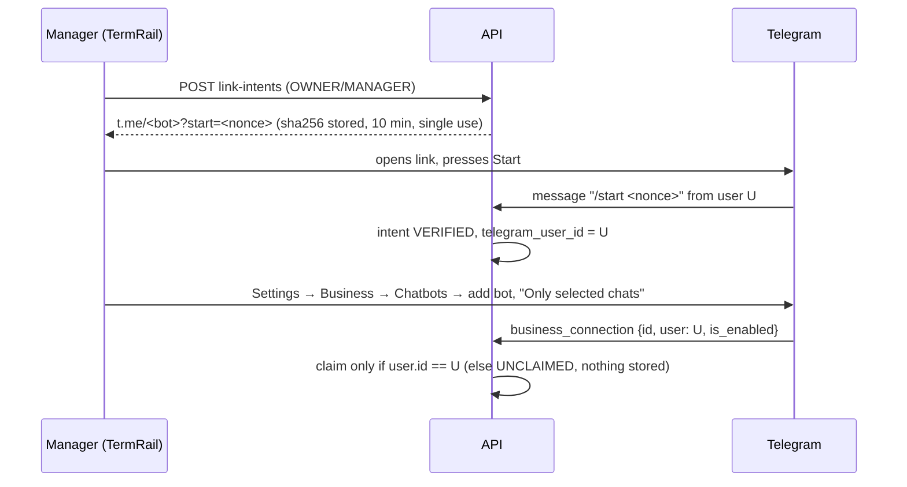

# Telegram Business connector — architecture

Status: implemented as a read-only vertical slice (Phases 2–3). Verified with real PostgreSQL, the real
webhook route, the real worker and (in one rehearsal) the real Gemini provider. **Not yet verified against a
live Telegram Business account** — see `IMPLEMENTATION_REPORT.md`.

## 1. Telegram capabilities we rely on

Official Bot API only (no MTProto, userbot, session strings or scraping).

| Update | Used for |
|---|---|
| `message` (private chat with the bot) | Only `/start <nonce>` — the ownership handshake. Other messages are ignored and never stored. |
| `business_connection` | The account owner added/changed/disabled the bot in *Telegram Business → Chatbots*. Carries `id`, `user`, `is_enabled`, `rights`. |
| `business_message` / `edited_business_message` | Messages in chats the owner allowed. Identified by `business_connection_id`. |
| `deleted_business_messages` | Deletions in those chats. |

Constraints honoured: Telegram sends only chats the owner allowed and only new events (no history, no chat
list), so the picker can only show chats that actually produced an update. One business bot per Telegram
account (shown in the UI). No `sendMessage` or any other write method is called; `ALLOW_EXTERNAL_SEND`
stays `false`. Field names were implemented from the Bot API documentation; re-check
<https://core.telegram.org/bots/api-changelog> before the first live pilot (e.g. `rights` vs legacy
`can_reply`, both accepted).

## 2. Topology

```text
Telegram ──HTTPS POST (secret header)──▶ /api/v1/integrations/telegram/webhook   (no bearer auth)
                                            │ one DB transaction:
                                            │  receipt (bot_id, update_id) UNIQUE → dispatch → commit → 200
                                            ▼
                         PostgreSQL ── telegram_* tables, commercial_signals, jobs
                                            ▲
Durable worker (same codebase) ─────────────┘
  telegram_finalize_batch  → prefilter → intake (TELEGRAM request) → analyze_request (existing)
  analyze_request done/failed → telegram_build_signals → commercial_signals (+ exact message evidence)

Web (authenticated) ── /workspaces/{ws}/integrations/telegram/* , /projects/{id}/telegram/* ,
                       /projects/{id}/commercial-signals , /commercial-signals/{id}/*
```

Code: `apps/api/app/integrations/telegram/` (`schemas`, `ingress`, `linking`, `bindings`, `batching`,
`prefilter`, `signals`, `crypto`, `retention`), routes in `app/api/telegram_webhook.py` and
`app/api/v1/telegram.py`, models in `app/db/models/telegram.py`, migration `0004`. Web:
`apps/web/src/features/telegram/`.

## 3. Ownership linking



Either order works: a `business_connection` that arrives first is stored `UNCLAIMED` (no workspace,
nothing ingested) and is claimed when a verified handshake from the same Telegram id lands (within 24 h).
A live connection is never moved between workspaces; after a disconnect, a new workspace gets a fresh row
and the old tenant's history stays with the old tenant (archived connection id).

## 4. Double allowlist and activation

1. The owner allows chats in Telegram (Telegram-side allowlist).
2. In TermRail a manager binds **one observed private chat** to **one project** (DB unique partial indexes
   in both directions) and enables monitoring, which requires: active project, approved baseline
   (`409 BASELINE_REQUIRED`), connection `CONNECTED` + enabled, explicit privacy acknowledgement.

Message bodies are stored (Fernet-encrypted) only while a chat is bound **and** monitoring is on. Other
allowed chats produce only a candidate row (chat id, display name, last seen) for the picker.

## 5. Batching (sliding debounce)

```mermaid
sequenceDiagram
  participant W as Webhook
  participant DB
  participant J as Worker
  W->>DB: message → OPEN batch (one per binding), quiet_until = now+120s (≤ first+900s; cap 100 msgs)
  W->>DB: job telegram_finalize_batch (idempotency key = batch id), next_run_at = quiet_until
  J->>DB: claim (FOR UPDATE SKIP LOCKED) — if now < quiet_until → JobDeferred (no attempt used)
  J->>DB: lock batch; re-check all activation conditions (fail closed → CANCELLED + bodies erased)
  J->>DB: snapshot version+hash per message; prefilter; compose inbound CANDIDATE text with offsets
  J->>DB: TIMELINE/PAYMENT → signals; create TELEGRAM request (origin=INTEGRATION); start analysis
```

Time comes from `app.core.clock` so tests move a controlled clock instead of sleeping.

## 6. Analysis and signals

The existing evidence-gated pipeline is reused unchanged: split into atomic requirements (exact
substrings), server-built contract candidates, fabricated refs rejected, quotes taken from stored spans,
policy gates ("silence is not a change", warranty verification, low confidence → review). The run is
pinned to the approved baseline at finalization.

`telegram_build_signals` maps each finding that needs a human (change candidate, ambiguous, insufficient
evidence, or any `needs_review`) to a signal. Each Telegram citation is computed from the request item's
offsets and the stored segment offsets: `(message, content_version, sha256, start, end)`. Readers see the
quote only if the current ciphertext decrypts to text with the same hash.

Dedup: per-project advisory lock; open signals of the same family (`SCOPE`, `BUG_FIX`, `TIMELINE`,
`PAYMENT`) are matched by exact fingerprint or Jaccard ≥ 0.5 on stemmed content words. A match adds an
occurrence and evidence; it never creates a second notification. Distinct families never merge.

Failure: a terminally failed analysis yields an `UNANALYZED` signal with the messages as evidence — never a
silent "no change". A later successful retry resolves it.

## 7. Edits, deletions, revocation, retention

| Event | Before finalization | After finalization |
|---|---|---|
| Edit | snapshot uses the newest version | evidence → `CHANGED`; decided cases reopen |
| Delete | body erased, excluded from analysis | body erased, evidence → `REVOKED` |
| `is_enabled=false` | connection `ACCESS_REVOKED`, monitoring off, open batch cancelled and erased | cases stay |
| Disconnect (TermRail) | bindings closed, open batch erased | cases stay |
| Retention (90 d default) | — | bodies erased by `python -m app.integrations.telegram.retention`; evidence `REVOKED` |

## 8. Commercial workflow

A signal links to the regular request review. "Estimate & draft change order" opens it; estimates use only
the rate card and human-entered hours; `create-change-order-draft` delegates to the existing change-order
domain and produces a `DRAFT`. No price, approval, client acceptance, payment state or message is ever
produced automatically. The v1 Commercial Authorization / `Start Work` gate remains backlog (spec §19).

## 9. Failure modes

| Failure | Behaviour |
|---|---|
| DB error during webhook | transaction rolls back (receipt included) → 5xx → Telegram redelivers |
| Duplicate / replayed update | receipt conflict → `200 DUPLICATE_UPDATE`, no effect |
| Unparseable update | acknowledged and ignored (no infinite redelivery), logged without content |
| Worker crash mid-finalize | lease expires, job reclaimed; batch row lock + state check prevent double processing |
| Two workers | `FOR UPDATE` on batch → one request; per-project advisory lock → one signal |
| AI 429/outage | job retries with backoff, then `UNANALYZED` signal |
| Baseline changed later | signal shows `stale_baseline`; never silently re-evaluated |
| Wrong/rotated data key | quote shown as unavailable, never garbage |
